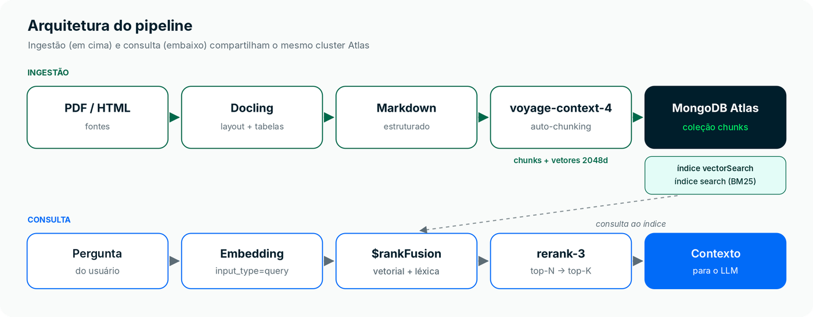

# Módulo 01 · Qualidade de contexto

**Um LLM é tão bom quanto o contexto que recebe.** Este módulo constrói, célula por célula, um pipeline de recuperação completo em um único cluster MongoDB Atlas, atacando quatro problemas: chunk órfão, termo exato, ranking ruim e custo de memória.

## Arquivos

| Arquivo | Descrição |
|---------|-----------|
| [`notebooks/hands_on_qualidade_de_contexto.ipynb`](notebooks/hands_on_qualidade_de_contexto.ipynb) | Notebook do hands-on em PT-BR, com os diagramas embutidos |
| [`slides/hands_on_qualidade_de_contexto.pdf`](slides/hands_on_qualidade_de_contexto.pdf) | Apresentação em PDF (19 slides) |
| [`assets/diagramas/`](assets/diagramas/) | Diagramas em PNG (os mesmos do notebook e da apresentação) |
| [`originais_en/`](originais_en/) | Notebook e apresentação originais em inglês (PDF) |

## Agenda (~2 horas)

| Etapa | Seção do notebook | Tema | Tempo |
|-------|-------------------|------|-------|
| 0 | §0–3 | Preparação no Atlas (M10 + API key), dependências e clientes | 10 min |
| 1 | §4 | Ingestão com Docling | 10 min |
| 2 | §5 | Embeddings contextualizados (`voyage-context-4`) | 15 min |
| 3 | §6 | Matryoshka (2048 → 256 dimensões) | 10 min |
| 4 | §7–8.1 | Gravação no Atlas: BinData + índices | 10 min |
| 5 | §8.2–8.4 | Busca vetorial e funções de similaridade | 15 min |
| 6 | §8.5 | Exercício ANN × ENN e a fase de avaliação | 20 min |
| 7 | §9 | Busca híbrida com `$search` + `$rankFusion` | 15 min |
| 8 | §10–11 | Reranking com `rerank-3` e `retrieve()` | 15 min |

## Observações

- As credenciais (`MONGODB_URI`, `VOYAGE_API_KEY`) são preenchidas na célula da seção 3.1.
- A seção 12 apaga as coleções e os índices criados pelo hands-on.
