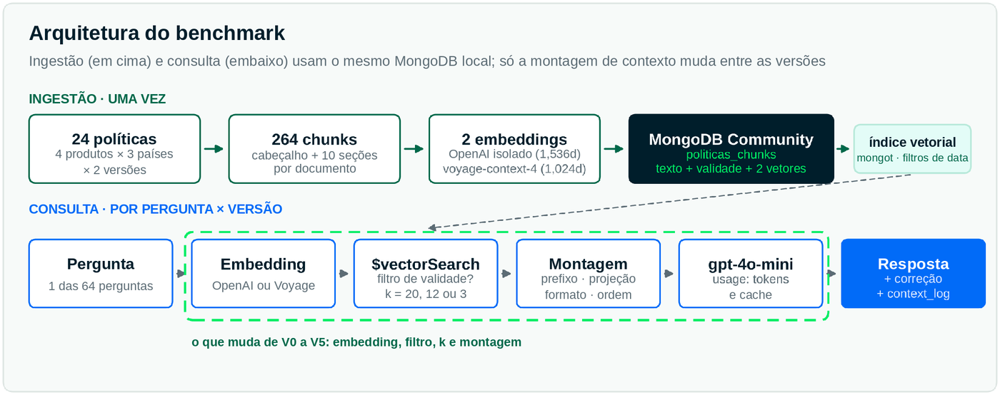

# Módulo 02 · Montagem de contexto

**Contexto bem montado.** Este módulo mede, com números reais de API, como a montagem do contexto (o que entra na janela do modelo, em que ordem e em que formato) define a acurácia, a latência e o custo de um assistente de IA. O banco, o modelo e as instruções ficam fixos; só a montagem muda, uma prática por vez.

## Arquivos

| Arquivo | Descrição |
|---------|-----------|
| [`notebooks/hands_on_montagem_de_contexto.ipynb`](notebooks/hands_on_montagem_de_contexto.ipynb) | Notebook do benchmark em PT-BR, com os diagramas embutidos |
| [`slides/hands_on_montagem_de_contexto.pdf`](slides/hands_on_montagem_de_contexto.pdf) | Apresentação em PDF (23 slides) |
| [`assets/diagramas/`](assets/diagramas/) | Diagramas e gráficos em PNG |
| [`originais_en/`](originais_en/) | Notebook e apresentação originais em inglês (PDF) |

## A escada de ablação

| Versão | Prática adicionada |
|--------|--------------------|
| V0 | Ponto de partida: 20 chunks, registro inteiro em JSON, sem filtro, data no topo do prompt |
| V1 | Prefixo estável (habilita o cache do provedor) |
| V2 | Projeção e tags com proveniência |
| V3 | Filtro de vigência no `$vectorSearch` |
| V4 | k escolhido por avaliação |
| V5 | Embeddings contextualizados com `voyage-context-4` |

## Pré-requisitos

- **Banco:** MongoDB Community 8.2+ com `mongot` via Docker (`docker-compose.yml`, `setup.sh`) **ou** um cluster MongoDB Atlas M10 (passo a passo na seção 0.2 do notebook).
- **Chaves:** OpenAI (`gpt-4o-mini` e `text-embedding-3-small`) e Voyage AI (`voyage-context-4`; criação da model key no Atlas na seção 0.3).
- Python 3.10+ e Jupyter. Uma execução completa leva de 10 a 15 minutos e custa cerca de US$ 0,30.

## Observações

- As credenciais (`OPENAI_API_KEY`, `VOYAGE_API_KEY`, `MONGODB_URI`) são preenchidas na célula da seção 1.
- O corpus, as perguntas e as instruções do assistente estão em português.
- Os arquivos do Docker (`docker-compose.yml`, `setup.sh` e as configurações do `mongod` e do `mongot`) citados no notebook ainda não estão neste repositório.
